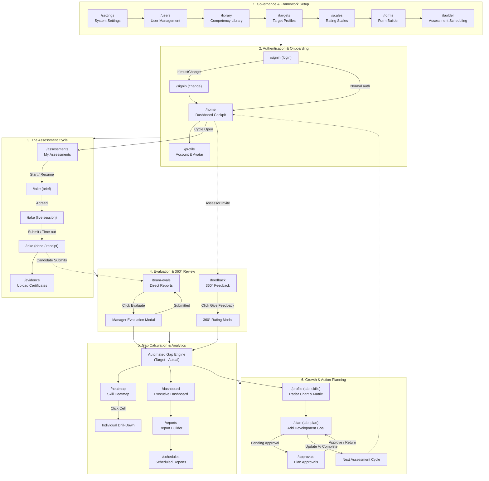

# Process Flow & Page Relationships: Skill Matrix & Assessment Platform (DVLA)

This document provides an end-to-end architectural and process-flow breakdown of all the pages in the application, distinguishing between **true physical route pages**, **multi-view host components**, **route aliases/umbrella redirects**, and **"pages that are not really pages" (pseudo-pages, tabs, stage-machines, and overlay modal flows)**.

---

## 1. Architectural Overview: Routing Anatomy

The application utilizes a **hybrid architecture**:
1. **Physical Next.js App Router**: 28 directories under `app/` contain `page.jsx` files for clean SEO-friendly URLs and direct browser access.
2. **Client-Side Virtual Router (`AppRouter.jsx` & `SkillMatrixApp.jsx`)**: Every physical route page imports and renders `<AppRouter initialPage="..." />`. State is synchronized with `window.history.pushState` and browser `popstate`.
3. **Component-Level Multi-Page Hosting**: Many distinct logical pages are rendered by shared master components (`SMAnalytics`, `SMTeam`, `SMFramework`, `SMSystem`, `SMAssessments`) switching views via props.

```
┌────────────────────────────────────────────────────────────────────────┐
│                        Physical Next.js Routes                         │
│   /signin  /home  /profile  /assessments  /take  /evidence  /plan ... │
└───────────────────────────────────┬────────────────────────────────────┘
                                    │ wraps
                                    ▼
┌────────────────────────────────────────────────────────────────────────┐
│                      AppRouter.jsx (Client Router)                     │
│               Syncs window.location <───> Browser History              │
└───────────────────────────────────┬────────────────────────────────────┘
                                    │ delegates
                                    ▼
┌────────────────────────────────────────────────────────────────────────┐
│                    SkillMatrixApp.jsx (Application Shell)              │
│       Role Guard · Header · Collapsible Sidebar · Notification Bell    │
│        Quick Notes Drawer · Header Department Scope · Feature Flags    │
└───────┬─────────┬──────────┬───────────┬──────────┬──────────┬─────────┘
        │         │          │           │          │          │
        ▼         ▼          ▼           ▼          ▼          ▼
    SMSignIn   SMHome    SMProfile  SMAssessments  SMTeam   SMAnalytics
        │                                │          │          │
        ▼                                ▼          ▼          ▼
   SMAssessmentSession              SMFramework  SMFormBuilder SMSystem
```

---

## 2. Taxonomy of Pages: "Real Pages" vs. "Pages That Are Not Really Pages"

### Category A: Standalone Real Pages (Dedicated Shell & Component)
These pages own their entire screen or primary layout and represent discrete user tasks.

| Route / View | Component | Description & Role |
| :--- | :--- | :--- |
| `/signin` | [`SMSignIn.jsx`](file:///c:/Users/PC/Desktop/skill-metrix-Denzil/components/SMSignIn.jsx) | Full-screen authentication gateway (no app shell). |
| `/home` | [`SMHome.jsx`](file:///c:/Users/PC/Desktop/skill-metrix-Denzil/components/SMHome.jsx) | Central operational cockpit with cycle status, KPIs, calendar, and quick CTAs. |
| `/take` | [`SMAssessmentSession.jsx`](file:///c:/Users/PC/Desktop/skill-metrix-Denzil/components/SMAssessmentSession.jsx) | Full-screen timed assessment engine with anti-cheat controls (no standard shell). |
| `/forms` | [`SMFormBuilder.jsx`](file:///c:/Users/PC/Desktop/skill-metrix-Denzil/components/SMFormBuilder.jsx) | Advanced visual assessment builder with live test previews and conditional logic. |

---

### Category B: Route Aliases / Umbrella Redirects
These routes exist as physical directories in `app/`, but **do not render a unique screen**. They immediately resolve to another view or tab in `resolvePageAndActive()`:

| Route | Resolves To | Underlying Implementation | Behavior |
| :--- | :--- | :--- | :--- |
| `/plan` | `/profile?tab=plan` | [`SMProfile.jsx`](file:///c:/Users/PC/Desktop/skill-metrix-Denzil/components/SMProfile.jsx) (Tab `plan`) | Virtual page alias. The sidebar highlights "Development Plan", but the view rendered is the Profile component with the Plan tab pre-selected. |
| `/analytics` | `/dashboard` | [`SMAnalytics.jsx`](file:///c:/Users/PC/Desktop/skill-metrix-Denzil/components/SMAnalytics.jsx) (View `dashboard`) | Section root. Default landing page for Analytics is Executive Dashboard. |
| `/team` | `/team-evals` | [`SMTeam.jsx`](file:///c:/Users/PC/Desktop/skill-metrix-Denzil/components/SMTeam.jsx) (View `team-evals`) | Section root. Default landing page for My Team is Team Evaluations. |
| `/framework` | `/library` | [`SMFramework.jsx`](file:///c:/Users/PC/Desktop/skill-metrix-Denzil/components/SMFramework.jsx) (View `library`) | Section root. Default landing page for Skill Framework is Competency Library. |
| `/system` | `/settings` | [`SMSystem.jsx`](file:///c:/Users/PC/Desktop/skill-metrix-Denzil/components/SMSystem.jsx) (View `settings`) | Section root. Default landing page for Administration is System Settings. |

---

### Category C: Multi-View Host Components (One Component, Multiple Pages)
These single React components switch their entire rendered UI based on the `view` prop passed from `SkillMatrixApp`:

| Host Component | Dispatched Route Pages | Logical UI Pages Rendered |
| :--- | :--- | :--- |
| [`SMAssessments.jsx`](file:///c:/Users/PC/Desktop/skill-metrix-Denzil/components/SMAssessments.jsx) | `/assessments`<br>`/evidence` | 1. **My Assessments**: Cycle lifecycle, status tracker, historical reports list.<br>2. **Evidence & Certifications**: File upload (certifications, work samples) linked to competencies, status verification table. |
| [`SMTeam.jsx`](file:///c:/Users/PC/Desktop/skill-metrix-Denzil/components/SMTeam.jsx) | `/team-evals`<br>`/feedback`<br>`/approvals` | 1. **Team Evaluations**: Direct reports roster, self vs manager eval tracking, evaluation trigger.<br>2. **360° Feedback**: Multi-source peer/upward review requests and status.<br>3. **Plan Approvals**: Employee development action approval queue with status filters. |
| [`SMAnalytics.jsx`](file:///c:/Users/PC/Desktop/skill-metrix-Denzil/components/SMAnalytics.jsx) | `/dashboard`<br>`/heatmap`<br>`/reports`<br>`/schedules` | 1. **Executive Dashboard**: KPI summary cards, department bar charts, historical trend graph, gap distribution.<br>2. **Skill Heatmap**: Organization-wide matrix with cell click drill-down to employee records.<br>3. **Report Builder**: Custom ad-hoc reports, column select, export to PDF/CSV/Excel/JSON/XML.<br>4. **Scheduled Reports**: Automated delivery configs (Daily, Weekly, Monthly) to email recipients. |
| [`SMFramework.jsx`](file:///c:/Users/PC/Desktop/skill-metrix-Denzil/components/SMFramework.jsx) | `/library`<br>`/targets`<br>`/scales`<br>`/builder` | 1. **Competency Library**: Department $\rightarrow$ Major $\rightarrow$ Specific Competency 3-level tree.<br>2. **Target Profiles**: Job Role $\times$ Competency benchmark target grid.<br>3. **Rating Scales**: Global definitions for Proficiency, Importance, and Gaps.<br>4. **Assessment Scheduling**: Cycle scheduling, pass marks, anti-cheat switches, question weighting. |
| [`SMSystem.jsx`](file:///c:/Users/PC/Desktop/skill-metrix-Denzil/components/SMSystem.jsx) | `/users`<br>`/audit`<br>`/settings`<br>`/help` | 1. **User Management**: Staff directory, role assignments, temporary password generator.<br>2. **Audit Logs**: Tamper-evident activity trail (Auth, Assessment, Integrity, Config, Export).<br>3. **System Settings**: Global assessment parameters, security, retention rules.<br>4. **Help & Guides**: FAQ knowledgebase with search and ticket dispatch. |

---

### Category D: "Pages That Are Not Really Pages" (Pseudo-Pages, Tabs & State Machines)
These are interfaces that look and behave like dedicated pages, but are managed purely in internal component state:

#### 1. In [`SMProfile.jsx`](file:///c:/Users/PC/Desktop/skill-metrix-Denzil/components/SMProfile.jsx) (4 Virtual Sub-Pages via Tabs)
* **Account Profile (`tab === 'account'`)**: Employee personal dossier, employment details, and active devices list.
* **Skill Profile (`tab === 'skills'`)**: Interactive SVG radar/spider chart, gap breakdown summary, and major competency matrix.
* **Assessment History (`tab === 'history'`)**: Archival logs of previous cycles with individual PDF download actions.
* **Development Plan (`tab === 'plan'` / accessed via `/plan`)**: Goal creation form, competency gap linkages, progress slider ($0\%-100\%$), and manager approval status tracking.

#### 2. In [`SMAssessmentSession.jsx`](file:///c:/Users/PC/Desktop/skill-metrix-Denzil/components/SMAssessmentSession.jsx) (3 Stage Transitions at `/take`)
* **Briefing Stage (`stage === 'brief'`)**: Candidate rules agreement, time constraints, tab-switch policy disclosure, and "Start Assessment" launch.
* **Live Assessment Stage (`stage === 'live'`)**: Fullscreen timed exam runner with question stepper, randomized ordering, question flagger, anti-cheat window-blur strike detector, and auto-submit timer.
* **Tamper-Evident Receipt (`stage === 'done'`)**: Post-submission confirmation display with cryptographic reference code, elapsed time, strike count, and result release date.

#### 3. In [`SMFormBuilder.jsx`](file:///c:/Users/PC/Desktop/skill-metrix-Denzil/components/SMFormBuilder.jsx) (4 Internal Workspaces at `/forms`)
* **Build Canvas (`tab === 'build'`)**: 10 question types palette, drag-and-drop canvas, and question property inspector (conditional logic, scale selection, option scoring).
* **Scoring Model (`tab === 'scoring'`)**: Pass threshold configuration, weighted scoring engine, and proficiency tier assignments.
* **Live Test Engine (`tab === 'preview'`)**: Interactive form simulator that tests conditional branches, runs draw-to-sign signature pads, mocks GPS capture, and computes real-time scores.
* **Version History (`tab === 'history'`)**: Version rollback table (Draft, Published, Superseded), version notes, and release history.

#### 4. In [`SMSignIn.jsx`](file:///c:/Users/PC/Desktop/skill-metrix-Denzil/components/SMSignIn.jsx) (2 Auth Stages at `/signin`)
* **Standard Login (`step === 'login'`)**: Username/email credentials entry, password visibility toggle, role switch shortcuts, and admin reset reminder.
* **Forced First-Time Password Reset (`step === 'change'`)**: Triggered when `mustChange === true`. Enforces complex password rules and confirmation before granting access.

#### 5. Interactive Overlay Drawers & Modals (Act like floating sub-pages)
* **Manager Evaluation Modal** in `SMTeam`: Detailed rating sheet rating direct reports competency-by-competency against targets.
* **360° Feedback Modal** in `SMTeam`: Multi-rater feedback submission for peers, managers, and cross-department colleagues.
* **Create User & Temporary Credentials Modal** in `SMSystem`: Multi-step user onboarding with credentials clipboard copy.
* **Active Devices Revocation Modal** in `SMProfile`: Session security review allowing remote logout of other sessions.
* **Global Quick Notes Drawer** in `SkillMatrixApp`: Floating scratchpad overlay persisted to `localStorage` (`skm-notes`).
* **Global Notifications Dropdown** in `SkillMatrixApp`: Direct navigation action center.

---

## 3. Process Flow Level: The End-to-End Enterprise Lifecycle

The relationship between all pages is governed by the DVLA Skill Assessment Lifecycle. The process flows through six sequential phases:



---

## 4. Detailed Step-by-Step Flow Matrix

### Phase 1: Governance & Framework Setup
* **Who**: `Administrator`, `Assessment Creator`
1. Admin configures global assessment policies (window hours, duration, tab limits, data retention) at [`/settings`](file:///c:/Users/PC/Desktop/skill-metrix-Denzil/app/settings/page.jsx).
2. Admin registers staff and assigns role permissions at [`/users`](file:///c:/Users/PC/Desktop/skill-metrix-Denzil/app/users/page.jsx), generating temporary passwords.
3. Assessment Creator builds the 3-level competency hierarchy (Department $\rightarrow$ Major Skill $\rightarrow$ Competency) at [`/library`](file:///c:/Users/PC/Desktop/skill-metrix-Denzil/app/library/page.jsx).
4. Creator establishes expected baseline ratings ($1-5$) for each Job Role at [`/targets`](file:///c:/Users/PC/Desktop/skill-metrix-Denzil/app/targets/page.jsx).
5. Rating scales and definitions are verified at [`/scales`](file:///c:/Users/PC/Desktop/skill-metrix-Denzil/app/scales/page.jsx).
6. Creator uses [`/forms`](file:///c:/Users/PC/Desktop/skill-metrix-Denzil/app/forms/page.jsx) to design the question structure (Likert, Single Choice, Multi-select, Matrix, File, Signature, GPS) with scoring tiers and conditional logic.
7. Assessment is scheduled and published for a designated date window at [`/builder`](file:///c:/Users/PC/Desktop/skill-metrix-Denzil/app/builder/page.jsx).

---

### Phase 2: Authentication & Onboarding
* **Who**: `All Users`
1. User arrives at [`/signin`](file:///c:/Users/PC/Desktop/skill-metrix-Denzil/app/signin/page.jsx).
2. If initial sign-in with temporary password (`mustChange: true`), the user is routed to the `change` stage to set a compliant password.
3. Upon success, user lands on [`/home`](file:///c:/Users/PC/Desktop/skill-metrix-Denzil/app/home/page.jsx).
4. User can visit [`/profile`](file:///c:/Users/PC/Desktop/skill-metrix-Denzil/app/profile/page.jsx) (tab `account`) to customize their avatar, inspect details, and review active device logins.

---

### Phase 3: Candidate Assessment Execution
* **Who**: `Participant (Staff)`
1. On assessment day, [`/home`](file:///c:/Users/PC/Desktop/skill-metrix-Denzil/app/home/page.jsx) displays an active gradient banner ("Your Q4 Skills Assessment is open today").
2. User clicks "Start Assessment", entering [`/take`](file:///c:/Users/PC/Desktop/skill-metrix-Denzil/app/take/page.jsx).
3. **Stage 1 (`brief`)**: Candidate reads integrity rules, anti-cheat limits, and confirms agreement.
4. **Stage 2 (`live`)**: Candidate enters fullscreen timed session.
   - Questions are served in randomized order.
   - Auto-saves to `localStorage` (`skm-session`) after each answer.
   - Switching tabs increments strikes; $3$ strikes triggers automatic integrity submission.
5. **Stage 3 (`done`)**: Candidate receives a timestamped submission receipt with reference code.
6. Candidate navigates to [`/evidence`](file:///c:/Users/PC/Desktop/skill-metrix-Denzil/app/evidence/page.jsx) to upload certificates (e.g., CCNA, ITIL) backing up their proficiency ratings.

---

### Phase 4: Manager Evaluation & 360° Review
* **Who**: `Manager / Supervisor`, `Peers`
1. When direct reports submit self-assessments, their status in [`/team-evals`](file:///c:/Users/PC/Desktop/skill-metrix-Denzil/app/team-evals/page.jsx) transitions to `Pending`.
2. Manager clicks "Evaluate", opening the **Manager Evaluation Modal**.
3. Manager inspects the employee's self-rating and assigns an independent rating ($1-5$) for each competency.
4. Simultaneously, nominated peers and colleagues navigate to [`/feedback`](file:///c:/Users/PC/Desktop/skill-metrix-Denzil/app/feedback/page.jsx) and complete the **360° Feedback Modal**.

---

### Phase 5: Gap Calculation & Executive Reporting
* **Who**: `Leadership`, `Managers`, `HR`
1. Once both candidate and evaluator inputs are locked, the platform calculates skill gaps:
   $$\text{Gap} = \max(0, \text{Target Level} - \text{Actual Level})$$
2. Leadership reviews the high-level health of the organization at [`/dashboard`](file:///c:/Users/PC/Desktop/skill-metrix-Denzil/app/dashboard/page.jsx) (average proficiency, critical gap counts, historical trends).
3. Leaders inspect Department $\times$ Category weak spots at [`/heatmap`](file:///c:/Users/PC/Desktop/skill-metrix-Denzil/app/heatmap/page.jsx), clicking any cell to drill down to specific employee records.
4. Custom compliance and audit registers are built at [`/reports`](file:///c:/Users/PC/Desktop/skill-metrix-Denzil/app/reports/page.jsx) and scheduled for recurring delivery at [`/schedules`](file:///c:/Users/PC/Desktop/skill-metrix-Denzil/app/schedules/page.jsx).

---

### Phase 6: Development Planning & Approval Loop
* **Who**: `Participant`, `Line Manager`
1. Employee visits [`/profile`](file:///c:/Users/PC/Desktop/skill-metrix-Denzil/app/profile/page.jsx) (tab `skills`) to inspect their visual radar spider chart and identify competencies with gaps.
2. Employee transitions to tab `plan` (or navigates directly to [`/plan`](file:///c:/Users/PC/Desktop/skill-metrix-Denzil/app/plan/page.jsx)).
3. Employee creates a targeted developmental action (e.g. *CompTIA CySA+ Certification*, *DR Drill*), linking it to a gap competency and target date.
4. The action is flagged as `Pending approval` and dispatched to the line manager.
5. Line manager visits [`/approvals`](file:///c:/Users/PC/Desktop/skill-metrix-Denzil/app/approvals/page.jsx), reviews proposed actions, and clicks **Approve** or **Return for Changes**.
6. Employee tracks ongoing completion progress ($0\%$ to $100\%$) via sliders on [`/plan`](file:///c:/Users/PC/Desktop/skill-metrix-Denzil/app/plan/page.jsx).
7. Progress feeds directly into the subsequent quarter's assessment cycle.

---

## 5. Summary Matrix: Routing & Visual Manifest

| URL Path | Host Component | View / Tab Identifier | Category | Primary Workflow Function |
| :--- | :--- | :--- | :--- | :--- |
| `/signin` | `SMSignIn` | `login` / `change` | Real Page (State Machine) | Authentication & force password change |
| `/home` | `SMHome` | default | Real Page | Central dashboard cockpit & timeline |
| `/profile` | `SMProfile` | `account` / `skills` / `history` / `plan` | Real Page (Tabbed Multi-View) | User dossier, radar chart, history, PDP |
| `/plan` | `SMProfile` | `tab='plan'` | **Route Alias (Virtual Page)** | Direct alias to Development Plan in Profile |
| `/assessments` | `SMAssessments` | `view='assessments'` | Multi-View Host | Assessment cycle tracking & history |
| `/take` | `SMAssessmentSession` | `brief` / `live` / `done` | Real Page (Stage Machine) | Timed anti-cheat assessment execution |
| `/evidence` | `SMAssessments` | `view='evidence'` | Multi-View Host | Certification & evidence document uploads |
| `/team` | `SMTeam` | `view='team-evals'` | **Route Alias (Section Root)** | Alias to Team Evaluations |
| `/team-evals` | `SMTeam` | `view='team-evals'` | Multi-View Host + Modal | Manager evaluation of direct reports |
| `/feedback` | `SMTeam` | `view='feedback'` | Multi-View Host + Modal | 360° multi-rater peer evaluations |
| `/approvals` | `SMTeam` | `view='approvals'` | Multi-View Host | Manager approval queue for PDP actions |
| `/analytics` | `SMAnalytics` | `view='dashboard'` | **Route Alias (Section Root)** | Alias to Executive Dashboard |
| `/dashboard` | `SMAnalytics` | `view='dashboard'` | Multi-View Host | Executive KPIs, charts & trends |
| `/heatmap` | `SMAnalytics` | `view='heatmap'` | Multi-View Host + Drilldown | Department gap matrix & drill-down |
| `/reports` | `SMAnalytics` | `view='reports'` | Multi-View Host | Ad-hoc report builder & file exports |
| `/schedules` | `SMAnalytics` | `view='schedules'` | Multi-View Host + Modal | Automated recurring report distribution |
| `/framework` | `SMFramework` | `view='library'` | **Route Alias (Section Root)** | Alias to Competency Library |
| `/library` | `SMFramework` | `view='library'` | Multi-View Host | Competency taxonomy management |
| `/targets` | `SMFramework` | `view='targets'` | Multi-View Host | Role baseline proficiency targets |
| `/scales` | `SMFramework` | `view='scales'` | Multi-View Host | Global proficiency and gap scale glossary |
| `/builder` | `SMFramework` | `view='builder'` | Multi-View Host | Assessment cycle publishing & weights |
| `/forms` | `SMFormBuilder` | `build`/`scoring`/`preview`/`history` | Real Page (Tabbed Workspaces) | Form & question builder, preview sandbox |
| `/system` | `SMSystem` | `view='settings'` | **Route Alias (Section Root)** | Alias to System Settings |
| `/users` | `SMSystem` | `view='users'` | Multi-View Host + Modal | User accounts & credential management |
| `/audit` | `SMSystem` | `view='audit'` | Multi-View Host | Tamper-evident activity & security logs |
| `/settings` | `SMSystem` | `view='settings'` | Multi-View Host | Global platform rules & configurations |
| `/help` | `SMSystem` | `view='help'` | Multi-View Host | FAQ knowledgebase & support contact |
